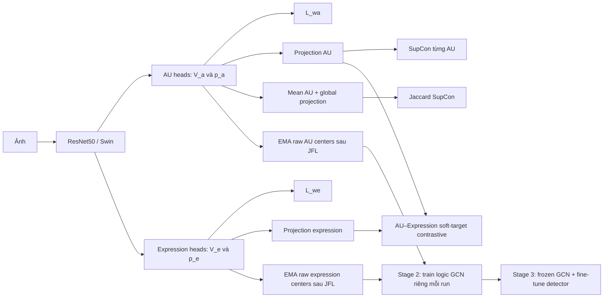

# Quy trình thực nghiệm Contrastive V1

Tài liệu này được chốt trước khi triển khai runner. Mục tiêu là kiểm định **có lợi,
có hại, hay chưa đủ bằng chứng**, không giả định contrastive chắc chắn tăng F1.
Các mức tăng F1 dự đoán trong trao đổi trước chưa có bằng chứng thực nghiệm.

## 1. Phạm vi và câu hỏi

Thực nghiệm chính: Stage 1 trên DISFA, 8 AU theo thứ tự
`1,2,4,6,9,12,25,26`; 7 expression theo matrix đi kèm.
BP4D chưa có matrix/rule tương ứng: không chạy bằng matrix DISFA.
Giữ backbone, AU/expression heads và đầu ra 256 chiều. Projection 128 chiều chỉ
dùng lúc train. Stage 2 dùng **V_a/V_e gốc**, không dùng projection để tính center.
Contrastive trên projection không bảo đảm các raw center cải thiện: cần đo downstream.

`L = L_wa + 0.05 L_we + ramp*(wg L_global + wn L_node + wx L_cross)`.

Node SupCon: so sánh **cùng AU i** qua các ảnh; anchor AU-on, positive AU-on
khác ảnh, negative AU-off. Không gom mọi AU-off thành một cluster vì lớp này
đa dạng và chiếm đa số. Mean loss theo AU có anchor hợp lệ; log coverage để biết
AU hiếm có được học hay không. Không có positive hoặc không có negative: bỏ AU
đó, trả zero có đường gradient khi cả batch không hợp lệ. Chưa dùng node queue.

Global: Jaccard mềm của tập AU; cùng ảnh bị mask. Cross: soft distribution từ
M_AE cho AU-on, tùy chọn hai chiều (hướng ngược dùng expression pseudo-label và
phân phối trên AU-on). Đây là **biến thể nghiên cứu**, không phải công thức gốc.
Không dùng pseudo-expression làm ground truth độc lập để tuyên bố FER tốt hơn.

## 2. Các đối chứng cố định

| Tên | Global | Node | Cross | Hướng cross | Queue global | Warm-up |
|---|---:|---:|---:|---|---:|---:|
| baseline | 0 | 0 | 0 | - | 0 | 3 |
| global | .05 | 0 | 0 | - | 0 | 3 |
| node | 0 | .05 | 0 | - | 0 | 3 |
| cross | 0 | 0 | .05 | hai chiều | 0 | 3 |
| full | .05 | .05 | .05 | hai chiều | 0 | 3 |
| current | .1 | 0 | .1 | AU → expression | 2048 | 1 |

`current` mô phỏng thiết kế contrastive đang có trong clone (đã có CL), trên cùng
runner kiểm soát. Không phải tái lập bit-for-bit checkpoint cũ. `full - baseline`
đo tổng tác động CL; `full - current` trả lời nâng cấp có hơn kiến trúc hiện tại.
Khác weight/queue giữa current và full là khác biệt thiết kế tổng thể, không quy
riêng lợi ích cho node loss. Muốn quy nguyên nhân, thêm `global_cross` (full bỏ node).
Các nhánh cơ sở dùng BCE expression đang có; thay Eq.(4) là ablation khác, không
lén sửa loss chỉ ở nhánh full. Runner mới không thay đổi objective WAL đang dùng.

## 3. Dữ liệu, chống leakage

1. Giữ 3 outer folds subject-independent từ list hiện có; kiểm tra không có
   subject giao nhau giữa outer train và test, không trùng path, nhãn nhị phân.
2. Trong outer train, lấy 3 subject validation bằng split seed cố định 2026.
   Split này dùng chung mọi training seed/variant. Fit dùng các subject còn lại.
   Từ 20/11/2026 (`splits_v2`): `--min-val-positive 100`, tức rút lại trên cùng
   luồng RNG tới khi mọi AU có >= 100 frame dương trong inner val. Lần rút đầu
   giống bản cũ, nên fold 2/3 không đổi; chỉ fold 1 đổi (val cũ có AU2 = 4 frame).
   Ràng buộc chỉ dùng nhãn outer train, không đụng outer test.
3. Lưu manifest và hash nội dung list/labels/matrix. Tính AU weight **chỉ từ fit**.
   Nếu AU không có mẫu dương trong fit thì dừng và xem lại split, không sinh inf.
4. Checkpoint chọn bằng macro-F1 inner-validation, ngưỡng AU cố định 0.5.
   Tie: giữ epoch sớm hơn. Không dùng outer test để chọn epoch, loss, weight,
   seed, augmentation, threshold hoặc phương án tốt nhất.
5. Outer test được gọi bằng lệnh evaluate riêng sau khi chốt thiết kế. Lưu
   probabilities + labels + subject/path để có thể kiểm tra và tổng hợp lại.
   Không đánh giá test mỗi epoch. Smoke test dùng dữ liệu tổng hợp hoặc inner val.
6. Tất cả ảnh của subject giữ nguyên split; không random frame split. Không tự
   sửa lệch frame/label, không bỏ frame lỗi: báo lỗi đường dẫn để sửa chuẩn bị data.

## 4. Ngân sách và fairness

ResNet50 ImageNet V1, 224px; AdamW lr=1e-4, wd=5e-4, betas=.9/.999;
cosine schedule 20 epochs, batch=32, temperature=.1. Cùng augmentation như
code cũ: resize 256, center crop 224, color jitter nhẹ ở train. Không thêm view
thứ hai trong V1. Không gradient accumulation (không làm tăng tập contrastive keys).
Ba training seeds `0,1,2`, ba folds `1,2,3`: mỗi variant có 9 runs.
Baseline và full là tối thiểu; current là đối chứng thứ hai cần chạy để trả lời
“hơn code hiện tại”. Chạy các nhánh đơn để phân tích; toàn bộ 7 nhánh = 63 runs.

Khởi tạo detector phải giống cho cùng seed giữa variants; tạo đủ projection heads
ở mọi variant, seed lại sampler/augmentation độc lập. Cùng batch thực và precision;
nếu OOM thì giảm batch cho **toàn bộ nhóm so sánh**. Lưu config, mã nguồn/hash,
phiên bản môi trường, source checkpoint, GPU, thời gian/epoch và peak VRAM.
Không giảm số frame/epochs riêng cho baseline. Không bật queue mặc định ở full;
queue là ablation bổ sung, keys từ mạng cũ có thể stale.

## 5. Kết luận hiệu quả

Primary metric: mean của macro-F1 trên 3 folds, trước tiên tính cho từng seed,
sau đó báo mean ± sample SD qua 3 seed (đơn vị percentage point).
Báo per-AU F1, chênh lệch ghép cặp cùng fold/seed, chi phí train và coverage node.
Không coi 9 runs là 9 quan sát hoàn toàn độc lập (train folds chồng nhau).
Bootstrap nếu dùng phải resample **subjects**, không resample frame độc lập;
3 seed không đủ để suy diễn chắc chắn significance. Báo cả suy giảm.
Không công bố “tốt hơn” chỉ từ best seed/best fold hoặc t-SNE đẹp.

Quy tắc mô tả: mean delta > 0 là cải thiện trung bình quan sát được; < 0 là suy
giảm quan sát được; biến thiên lớn/khác dấu qua seed thì chưa ổn định. Chưa có
chạy full dataset thì không được đưa số F1 dự đoán thành kết quả.

## 6. Stage 2–3: thực nghiệm downstream riêng

Chỉ sau khi chốt Stage 1, train lại Stage 2 và Stage 3 cho **mỗi** checkpoint tương
ứng, cùng inner split, seed và ngân sách 5 epochs/lr=.01 rồi 20 epochs/lr=1e-6.
Không chia sẻ class centers/GCN từ baseline sang full; không dùng outer test làm val.
Giữ graph/rule/objective giống nhau giữa các nhánh. Sửa đường dẫn Linux và
double-sigmoid trong clone cho cả hai nhánh; các sai lệch CNF/polarity/SAT còn lại
phải ghi nhận như hạn chế của downstream cũ, không gọi đây là reproduction paper.
Không thêm graph InfoNCE trong V1; đó là thí nghiệm Stage 2 độc lập về sau.

Stage-1 gain và Stage-3 gain là hai kết quả riêng. Stage-1 tốt hơn không bảo đảm
Stage-3 tốt hơn. Prototype/graph embeddings và visualization chỉ là diagnostic.

## 7. Colab và nguồn

Thực hiện theo `COLAB_PRO.md`. Checkpoint epoch-boundary có optimizer, queue và
RNG để tiếp tục run bị ngắt. Môi trường/hardware thay đổi vẫn có thể gây sai khác
số học. Không hứa thời lượng/GPU cố định trên Colab Pro.

- Supervised Contrastive Learning: https://arxiv.org/abs/2004.11362
- Colab FAQ (kiểm tra 2026-09-30): https://research.google.com/colaboratory/faq.html
- Paper SymGraphAU của người dùng và code gốc là nguồn cho ba stages; node/cross
  contrastive trong V1 là đề xuất, cần ablation để kiểm định.
